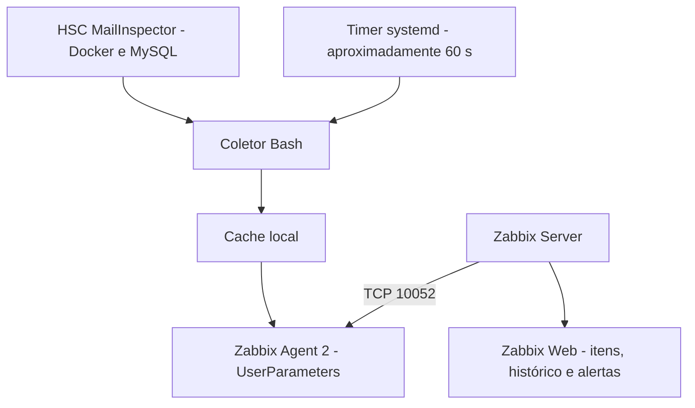

# Monitoramento HSC MailInspector com Zabbix Agent 2
{:.no_toc}

> **Ambiente:** Infraero — SCS e BRS  
> **Validação técnica:** 10/11/2026  
> **Status:** coleta local e consultas remotas validadas; cadastro e homologação no Zabbix Web pendentes.

<div class="toc-title">Sumário</div>
* Sumário
{:toc}

Documentação relacionada: [Instalação do Zabbix Agent no Linux]({{ 'monitoramento/instalacao-zabbix-agent-linux.html' | relative_url }}) e [Instalação do Zabbix Server]({{ 'monitoramento/instalacao-zabbix-server.html' | relative_url }}).

---

## 1. Objetivo

Documentar o monitoramento das filas de mensagens, conexões SMTP e limites operacionais do HSC MailInspector por meio do Zabbix Agent 2. Este procedimento abrange a configuração dos itens no Zabbix Web e a validação da solução já implantada nos servidores Linux.

## 2. Ambiente

| Equipamento | Host | IP | Porta do agente |
|---|---|---|---|
| MailInspector SCS | `s-sesu13468.infraero.gov.br` | `10.0.134.68` | TCP `10052` |
| MailInspector BRS | `s-brsu13468.infraero.gov.br` | `10.8.134.68` | TCP `10052` |
| Zabbix Server usado nos testes | `s-sebu26171` | `10.0.26.171` | Origem das consultas |

- **Agente:** Zabbix Agent 2, versão 6.2.9.
- **Método:** verificações passivas (`Zabbix agent`).
- **Coleta local:** timer systemd, aproximadamente a cada 60 segundos.
- **Validade máxima do cache:** 180 segundos.
- **Porta alternativa `10052`:** as portas `10050` e `10051` já são utilizadas no ambiente Docker.

## 3. Arquitetura



O coletor consulta os dados periodicamente e publica valores numéricos no cache. O Zabbix Agent 2 apenas lê esse cache quando recebe uma consulta, evitando executar operações Docker e SQL a cada requisição do servidor Zabbix.

## 4. Métricas disponíveis

| Chave | Descrição | Origem |
|---|---|---|
| `mli.qtotal` | Total de mensagens na fila | `mailqueue.sh total` |
| `mli.qincoming` | Mensagens na fila de entrada | `mailqueue.sh incoming` |
| `mli.split` | Métrica da fila `split` | `mailqueue.sh split` |
| `mli.proc` | Métrica da fila `proc` | `mailqueue.sh proc` |
| `mli.smtpconnections` | Conexões SMTP informadas pelo MailInspector | `mailqueue.sh connections` |
| `mli.fluxcontrol` | Registros que atingiram o limite de controle de fluxo | Consulta SQL de leitura no banco `policyd` |
| `mli.quotalimit` | Registros que atingiram o limite de quota | Consulta SQL de leitura no banco `policyd` |

**Observação:** valor `0` é válido e não indica, por si só, falha na coleta. As métricas `mli.fluxcontrol` e `mli.quotalimit` representam contagens de registros que atingiram os limites consultados, não necessariamente eventos novos no último minuto.

## 5. Configurar o Zabbix Web

### 5.1. Localizar os hosts

1. Acessar o Zabbix Web com permissão para configurar hosts e itens.
2. No Zabbix 6.2, abrir **Configuration → Hosts**. Em versões mais recentes, o menu pode aparecer como **Data collection → Hosts**.
3. Localizar os hosts correspondentes ao SCS e BRS.
4. **Reutilizar os hosts existentes**; não criar duplicatas sem necessidade.

### 5.2. Configurar a interface do agente

Na configuração de cada host, conferir a seção **Interfaces** e adicionar, se necessário, uma interface do tipo **Agent**:

| Campo | SCS | BRS |
|---|---|---|
| Type | `Agent` | `Agent` |
| Connect to | `IP` | `IP` |
| IP address | `10.0.134.68` | `10.8.134.68` |
| Port | `10052` | `10052` |

**Não substituir interfaces existentes** que atendam outros itens. Quando houver múltiplas interfaces, selecionar explicitamente a interface `10052` em cada novo item.

### 5.3. Criar o primeiro item

1. Na lista de hosts, clicar em **Items** no host SCS.
2. Clicar em **Create item**.
3. Preencher os campos abaixo.
4. Salvar o item.

| Campo | Configuração |
|---|---|
| Name | `MailInspector - Total de mensagens na fila` |
| Type | `Zabbix agent` |
| Key | `mli.qtotal` |
| Type of information | `Numeric (unsigned)` |
| Host interface | `10.0.134.68:10052` |
| Units | Em branco |
| Update interval | `1m` |
| History | `30d` (sugestão; seguir política interna) |
| Trends | `365d` (sugestão; seguir política interna) |
| Enabled | Sim |

### 5.4. Criar os demais itens

Repetir o procedimento para as sete chaves, em **ambos os hosts**:

| Nome do item | Key |
|---|---|
| MailInspector - Total de mensagens na fila | `mli.qtotal` |
| MailInspector - Fila de entrada | `mli.qincoming` |
| MailInspector - Fila split | `mli.split` |
| MailInspector - Fila proc | `mli.proc` |
| MailInspector - Conexões SMTP | `mli.smtpconnections` |
| MailInspector - Limite de controle de fluxo | `mli.fluxcontrol` |
| MailInspector - Limite de quota | `mli.quotalimit` |

**Parâmetros comuns:** tipo `Zabbix agent`, informação `Numeric (unsigned)`, atualização `1m`, interface TCP `10052` do respectivo host.

No BRS, selecionar `10.8.134.68:10052`. No SCS, selecionar `10.0.134.68:10052`.

## 6. Validar os dados no Zabbix Web

1. Abrir **Monitoring → Latest data** (Dados recentes).
2. Filtrar pelo host SCS e procurar `MailInspector`.
3. Confirmar que os sete itens recebem números, têm horário de verificação atualizado e não aparecem como **Not supported**.
4. Repetir a verificação no BRS.
5. Abrir o histórico de cada item e confirmar que existem amostras sucessivas.

**Atenção:** um resultado correto em `zabbix_get` comprova a consulta remota, mas **não substitui** a validação do armazenamento dos dados no Zabbix Web.

## 7. Testes por linha de comando

### 7.1. Consultar uma métrica remotamente

Executar no servidor Zabbix `s-sebu26171`:

```bash
# SCS
zabbix_get -s 10.0.134.68 -p 10052 -k mli.qtotal

# BRS
zabbix_get -s 10.8.134.68 -p 10052 -k mli.qtotal
```

### 7.2. Consultar todas as métricas dos dois servidores

```bash
for host in 10.0.134.68 10.8.134.68; do
    echo "===== $host ====="
    for key in \
        mli.qtotal \
        mli.qincoming \
        mli.split \
        mli.proc \
        mli.smtpconnections \
        mli.fluxcontrol \
        mli.quotalimit
    do
        printf '%-25s ' "$key"
        zabbix_get -s "$host" -p 10052 -k "$key"
    done
done
```

### 7.3. Verificar serviços e logs no host MailInspector

```bash
systemctl is-active zabbix-agent2
systemctl is-active zabbix-mailinspector.timer
systemctl list-timers --all --no-pager | grep zabbix-mailinspector
journalctl -u zabbix-mailinspector.service -n 20 --no-pager
```

### 7.4. Verificar a idade do cache

```bash
CACHE=/var/cache/zabbix-mailinspector
LAST=$(cat "$CACHE/last_success")
echo "Idade do cache: $(( $(date +%s) - LAST )) segundos"
```

O leitor rejeita cache expirado (mais de 180 segundos), inválido ou ausente.

## 8. Arquivos da implantação

| Caminho | Função |
|---|---|
| `/usr/local/sbin/zabbix-mailinspector-collect` | Coleta as sete métricas |
| `/usr/local/bin/zabbix-mailinspector-read` | Lê e valida os valores do cache |
| `/etc/zabbix/zabbix_agent2.d/mailinspector.conf` | Define os sete `UserParameter` |
| `/etc/systemd/system/zabbix-mailinspector.service` | Executa a coleta |
| `/etc/systemd/system/zabbix-mailinspector.timer` | Agenda as coletas |
| `/var/cache/zabbix-mailinspector/` | Armazena os valores e `last_success` |

Exemplo dos parâmetros personalizados:

```ini
UserParameter=mli.qtotal,/usr/local/bin/zabbix-mailinspector-read qtotal
UserParameter=mli.qincoming,/usr/local/bin/zabbix-mailinspector-read qincoming
UserParameter=mli.split,/usr/local/bin/zabbix-mailinspector-read split
UserParameter=mli.proc,/usr/local/bin/zabbix-mailinspector-read proc
UserParameter=mli.smtpconnections,/usr/local/bin/zabbix-mailinspector-read smtpconnections
UserParameter=mli.fluxcontrol,/usr/local/bin/zabbix-mailinspector-read fluxcontrol
UserParameter=mli.quotalimit,/usr/local/bin/zabbix-mailinspector-read quotalimit
```

O coletor executa o script `mailqueue.sh` do container HSC e consultas SQL **somente de leitura**. Não é necessário alterar o script original do fabricante.

## 9. Solução de problemas

| Sintoma | Verificações recomendadas |
|---|---|
| `Connection refused` | Agente ativo, endereço e porta `10052` |
| `Connection timed out` | Rotas, firewall e conectividade entre Zabbix Server e host |
| `ZBX_NOTSUPPORTED` | Chave, `UserParameter`, permissões e validade do cache |
| Cache expirado | Estado do timer e logs do serviço de coleta |
| Item sem dados no Zabbix Web | Interface selecionada, tipo do item, chave e disponibilidade do host |
| Falha com fila vazia | Tratamento de retorno do `mailqueue.sh` no coletor |

Comandos de diagnóstico **não destrutivos**:

```bash
ss -lntp | grep ':10052'
cat /etc/zabbix/zabbix_agent2.d/mailinspector.conf
zabbix_agent2 -c /etc/zabbix/zabbix_agent2.conf -t mli.qtotal
journalctl -u zabbix-mailinspector.service -p err --since '1 hour ago' --no-pager
```

### Observação sobre `Hostname`

Foi observado no BRS o valor literal `Hostname=systemc.hostname` no Zabbix Agent 2. Isso não impediu as consultas passivas testadas, mas pode afetar verificações ativas. **Não modificar essa configuração sem alinhamento com a equipe de Monitoramento.**

## 10. Gráficos e alertas sugeridos

Após confirmar o histórico, considerar gráficos de evolução da fila total, filas individuais, conexões SMTP e contagens de limites atingidos.

Alertas possíveis, **ainda não implantados**:

- Fila total acima de um limite operacional por um período sustentado.
- Crescimento contínuo da fila.
- Registros que atingiram limites de quota ou de controle de fluxo.
- Ausência de novos dados por mais de cinco minutos.

Definir limites e severidades com a equipe responsável, com base no comportamento normal do ambiente. Evitar limiares arbitrários.

## 11. Resultado da validação técnica — 10/11/2026

| Verificação | SCS | BRS |
|---|---|---|
| Coletor instalado e testado | Aprovado | Aprovado |
| Sete métricas locais | Aprovado | Aprovado |
| Timer systemd | Ativo | Ativo |
| Zabbix Agent 2 na porta `10052` | Validado | Validado |
| Consulta remota com `zabbix_get` | Aprovada | Aprovada |
| Cadastro dos itens no Zabbix Web | Pendente | Pendente |
| Histórico e alertas no Zabbix Web | Pendente | Pendente |

Na validação final do SCS, `mli.qtotal` retornou `62` e as demais métricas retornaram `0`. No teste remoto do BRS, as sete métricas retornaram `0`. Esses valores representam as respectivas coletas de teste, não limites operacionais.

**Conclusão:** a infraestrutura de coleta nos dois servidores foi validada. A homologação completa requer cadastrar os itens no Zabbix Web, confirmar o histórico e estabelecer os alertas com a equipe de Monitoramento.

## 12. Referência

- [Documentação oficial do Zabbix 6.2 — Items](https://www.zabbix.com/documentation/6.2/en/manual/config/items/item)
